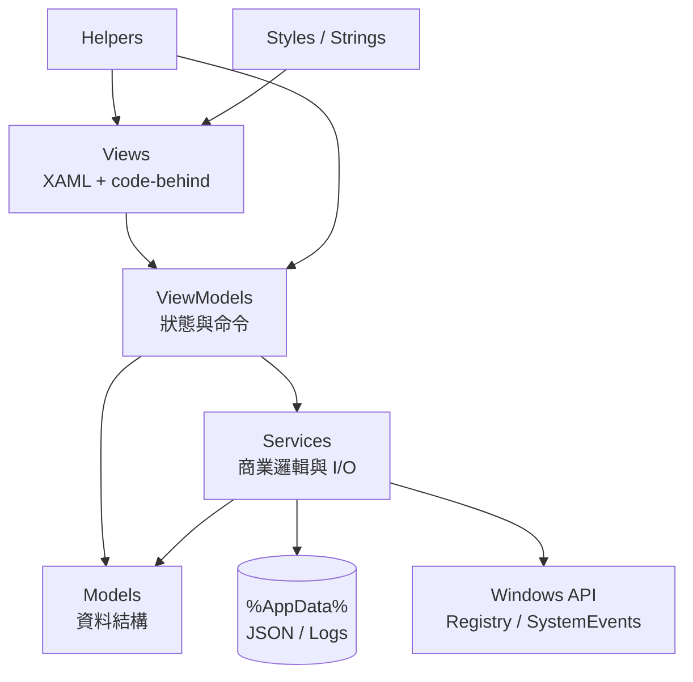
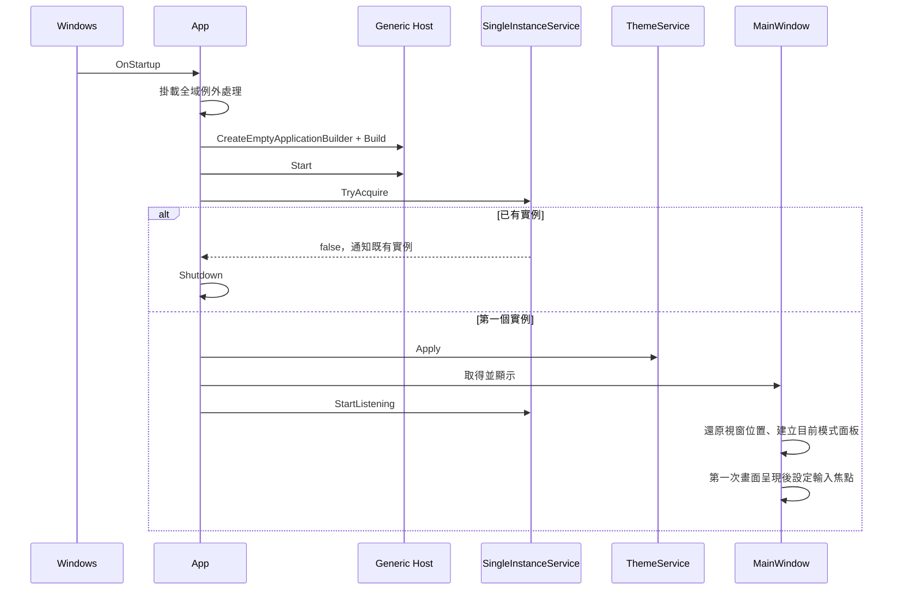
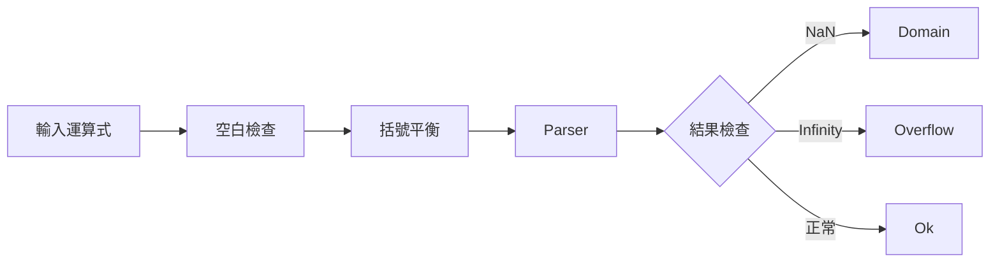
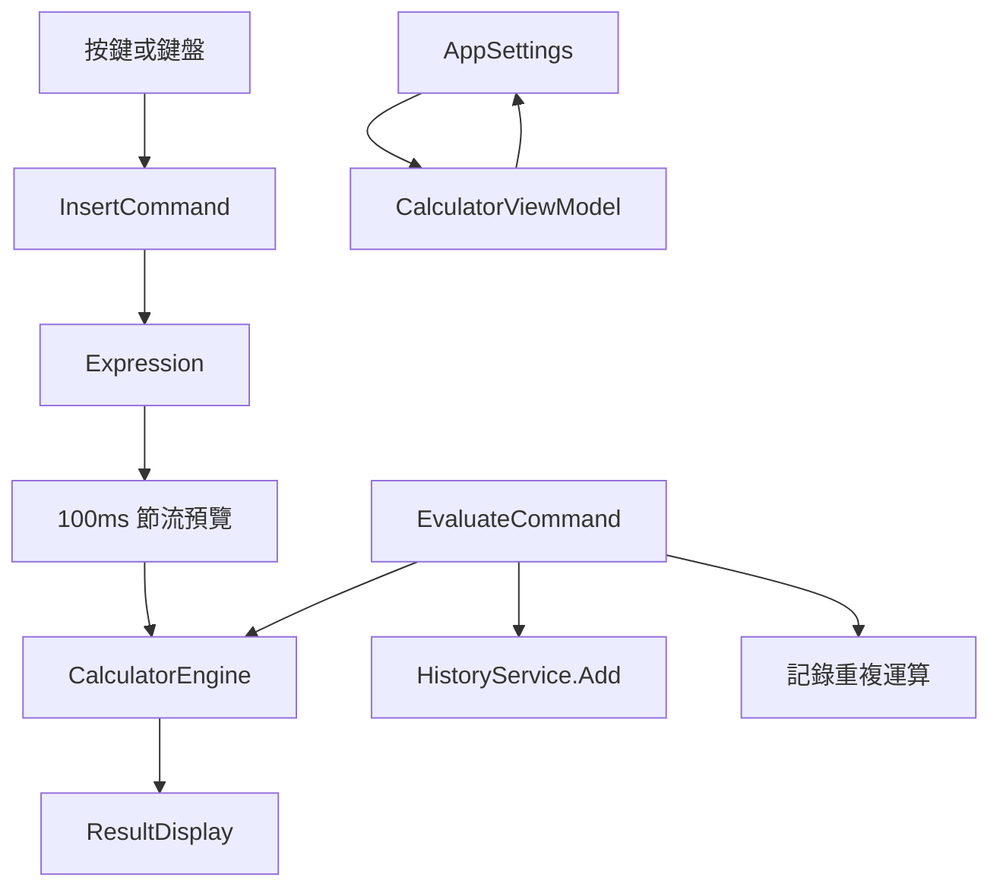
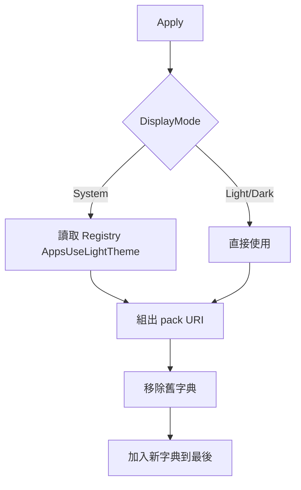
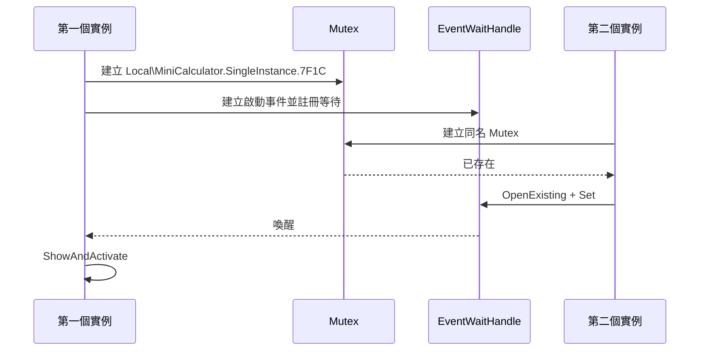

# 系統架構與技術文件

本文件說明 mini計算機的技術架構、模組職責、執行流程與重要設計決策。對應版本 1.6.0。

## 1. 技術基線

| 項目 | 內容 |
| --- | --- |
| 語言 | C#（nullable、file-scoped namespace） |
| 執行環境 | .NET 10 |
| 目標框架 | `net10.0-windows10.0.22000.0` |
| 最低平台 | Windows 11 build 22000 |
| UI | WPF + XAML |
| MVVM | CommunityToolkit.Mvvm 8.4.2 |
| 依賴注入 | Microsoft.Extensions.Hosting / DependencyInjection 10.0.15 |
| 日誌 | Microsoft.Extensions.Logging（Debug + 檔案） |
| JSON | System.Text.Json + source generation |
| 測試 | xUnit 2.9.3 |
| 套件管理 | Central Package Management（`Directory.Packages.props`） |
| 架構 | x64、ARM64（依 RuntimeIdentifier） |

## 2. 方案結構

```text
MiniCalculator.sln
├─ src/MiniCalculator/
│  ├─ App.xaml / App.xaml.cs          應用程式入口與 DI 容器
│  ├─ Models/                         DTO、列舉與求值結果
│  ├─ Services/                       求值、儲存、主題、單一實例、日誌
│  ├─ ViewModels/                     MVVM 狀態與命令
│  ├─ Views/                          主視窗、標準／科學／極小面板、歷史／設定視窗
│  ├─ Helpers/                        格式化、在地化、轉換器、視窗位置
│  ├─ Strings/Resources.resx          zh-Hant 使用者文字
│  ├─ Styles/                         共用樣式與 24 份主題字典
│  └─ Assets/app.ico                  應用程式圖示
├─ tests/MiniCalculator.Tests/        xUnit 測試
└─ docs/                              使用、架構、設計與發佈文件
```

## 3. 分層架構



### Views

- 只負責畫面呈現、事件轉接與視窗生命週期。
- 主視窗以 `ContentControl` 承載目前模式的 `StandardView`、`ScientificView` 或 `CompactView`，需要時才建立並快取。
- 極小模式由 `MainWindow` 切換尺寸、工具列與 `CompactView`，並處理置頂與視窗位置保存。
- 歷史與設定視窗由 `Func<HistoryWindow>`、`Func<SettingsWindow>` 工廠建立，避免 View 直接 new 服務。

### ViewModels

| ViewModel | 生命週期 | 職責 |
| --- | --- | --- |
| `CalculatorViewModel` | Singleton | 運算式、結果、預覽、記憶體、歷史、複製、模式內命令 |
| `ShellViewModel` | Singleton | 標準／科學模式選取與 `AppSettings` 同步 |
| `SettingsViewModel` | Transient | 設定繫結與恢復預設值 |
| `AboutViewModel` | Transient | 版本、檔案版本、授權與隱私資訊 |

### Services

| 服務 | 介面 | 職責 |
| --- | --- | --- |
| `CalculatorEngine` | `ICalculatorEngine` | 遞迴下降運算式求值 |
| `SettingsService` | `ISettingsService` | 設定載入、儲存與變更通知 |
| `HistoryService` | `IHistoryService` | 歷史紀錄載入、新增、清除與上限控管 |
| `ThemeService` | `IThemeService` | 顯示模式解析與主題字典置換 |
| `SingleInstanceService` | `ISingleInstanceService` | Mutex 單一實例與第二次啟動通知 |
| `JsonFileStore<T>` | 無 | 泛型 JSON 延遲合併寫入 |
| `FileLoggerProvider` | `ILoggerProvider` | 警告以上日誌寫入檔案 |

### Models

- `AppSettings`：可觀察的應用程式設定（顯示模式、主題、置頂、角度單位、記憶體、模式、科學記號、視窗位置、極小視窗位置）。
- `SettingsData`：存檔用純 DTO，避免序列化相依於 MVVM 產生的屬性。
- `EvaluationResult`：求值結果（成功、值、錯誤分類）。
- `HistoryEntry`：歷史紀錄項目。
- `WindowPlacement`：視窗位置與大小。
- 列舉：`DisplayMode`、`ThemeName`、`AngleUnit`、`CalculationError`。

## 4. 啟動流程



### 啟動效能措施（v1.5.1）

- 使用 `Host.CreateEmptyApplicationBuilder`，不載入未使用的預設組態來源。
- 標準／科學面板延後建立，只建構目前模式。
- 主題色票字典只在設定視窗載入。
- 歷史紀錄延後到第一次開啟歷史視窗或第一次新增時讀取。
- `JsonFileStore` 與檔案日誌只在實際寫檔時建立資料夾。
- 輸入焦點延後到 `DispatcherPriority.Input`，避免阻塞首次畫面呈現。

## 5. 運算式求值引擎

### 5.1 流程



`CalculatorEngine.Evaluate` 先處理空白與括號平衡，再交給內部 `Parser`。若缺少右括號會自動補齊；多出右括號則回報語法錯誤。求值後檢查 `NaN` 與 `Infinity`，分別對應定義域錯誤與溢位。

### 5.2 文法與優先序

由低至高：

```text
additive      := multiplicative (("+" | "-") multiplicative)*
multiplicative:= unary (("*" | "/" | "mod") unary | implicit unary)*
unary         := ("+" | "-") unary | power
power         := postfix ("^" unary)?
postfix       := primary ("%" | "!")*
primary       := number | "(" additive ")" | identifier
```

- `^` 為右結合，指數可再接一元運算。
- 隱含乘法在乘法層處理，僅在遇到數字、`(`、`π`、字母時觸發；`2e3` 不會被拆解。
- `%` 與 `!` 為後置運算，可連續使用。
- 一元負號的優先序低於次方，因此 `-2^2` 為 `-(2^2)`。

### 5.3 數字與識別字

- 數字支援小數點與 `E`／`E+`／`E-` 科學記號。
- 以 `ReadOnlySpan<char>` 搭配 `double.TryParse` 解析，降低字串配置。
- 識別字不分大小寫，支援 `pi`、`e`、`rand` 與函式呼叫。
- 函式參數以逗號分隔，目前內建函式皆為單參數。
- `π` 與 `×`、`÷`、`−` 等符號會正規化後再解析。

### 5.4 函式與角度單位

- 三角與反三角會依 `AngleUnit` 在度、弧度、百分度之間轉換。
- 雙曲與反雙曲直接使用 `Math` 對應函式，不受角度單位影響。
- `round` 採 `MidpointRounding.AwayFromZero`。
- 階乘僅接受非負整數，上限 170。
- `dms`／`deg` 實作十進位度與度分秒數值互轉。

### 5.5 錯誤模型

| 錯誤 | 意義 |
| --- | --- |
| `Syntax` | 語法錯誤、未知函式、參數數量不符 |
| `DivideByZero` | 除以零或 `mod` 除數為零 |
| `Domain` | 定義域錯誤（例如負數階乘、`NaN`） |
| `Overflow` | 結果溢位（例如階乘超過 170） |

未預期的例外會寫入日誌並回報 `Syntax`，避免例外外洩到 UI。

## 6. 狀態與命令流



`CalculatorViewModel` 是 UI 狀態的核心：

- `Expression`、`ResultDisplay`、`IsError`、`StatusMessage` 為可觀察屬性。
- `_justEvaluated` 控制按 `=` 後的編輯行為：直接輸入數字會開始新運算式，按 `⌫` 或編輯則接續結果。
- `_repeatOperator`、`_repeatOperand` 支援連按 `=`。
- 即時預覽使用 `DispatcherTimer` 節流 100ms，避免長運算式每次輸入都完整求值。
- 複製命令以 `CanExecute` 控制，錯誤狀態下不可複製。
- 記憶體與科學記號狀態同步回 `AppSettings`，由 `SettingsService` 持久化。

## 7. 設定與歷史儲存

### 7.1 JsonFileStore

`JsonFileStore<T>` 是共用的 JSON 儲存器：

- 400ms 延遲合併，避免每次屬性變更都寫檔。
- 背景 `Timer` 寫入，降低 UI 執行緒 I/O。
- `.tmp` + `Move` 原子寫入，降低檔案損毀風險。
- `Dispose`／`Flush` 時落地。
- 讀寫失敗會記錄日誌並回傳預設值，不讓程式崩潰。

### 7.2 序列化

- 使用 `System.Text.Json` source generation（`AppJsonContext`）。
- 存檔邊界使用 `SettingsData` 與 `List<HistoryEntry>`，避免直接序列化 `ObservableObject` 產生的屬性。
- 列舉以字串表示，方便閱讀與相容。

### 7.3 路徑

```text
%AppData%\MiniCalculator\settings.json
%AppData%\MiniCalculator\history.json
%AppData%\MiniCalculator\logs\app-yyyyMMdd.log
```

資料夾只在實際寫檔時建立。

## 8. 主題與顯示模式

### 8.1 資源字典

- `Styles/Themes/` 共有 24 份字典：12 款主題 × 淺色／深色。
- 每份字典直接定義 18 個 `SolidColorBrush`，不透過 `Color` 間接層。
- 元素與樣式以 `DynamicResource` 引用筆刷，替換字典即可即時更新。
- `ThemeSwatches.xaml` 單獨定義色票筆刷，讓設定頁在非目前主題下仍能顯示各自主色。

### 8.2 ThemeService



- 跟隨系統時讀取 `HKCU\...\Themes\Personalize\AppsUseLightTheme`。
- 監聽 `SystemEvents.UserPreferenceChanged`，系統主題變更時重新套用。
- 套用失敗會記錄日誌，不影響程式運作。

## 9. 在地化

- 使用者可見文字集中於 `Strings/Resources.resx`，預設 `zh-Hant`。
- XAML 透過 `LocExtension`（`{loc:Loc Key}`）取得資源。
- 程式碼透過 `Localization.Get(key)` 取得。
- 找不到資源時回傳 key，方便定位缺漏字串。

## 10. 單一實例



- 使用 `Local\` 命名空間，僅限目前工作階段。
- 第二次啟動會等待最多 20 次、每次 100ms，避免事件尚未建立時失敗。
- Mutex 建立失敗時視為可啟動，避免因權限問題完全無法使用。

## 11. 視窗狀態

- 關閉時以 `RestoreBounds` 保存位置、大小與最大化狀態。
- 啟動時檢查目標矩形是否與目前工作區或虛擬螢幕交集。
- 若與工作區交集，會夾限到工作區內，避免落在工作列下方。
- 若完全落在虛擬螢幕外，改用 `CenterScreen`。

## 12. 日誌與例外處理

- 使用 `Microsoft.Extensions.Logging`。
- Debug 版加入 `AddDebug`；所有版本加入 `FileLoggerProvider`。
- 檔案日誌只寫 Warning 以上，路徑為 `%AppData%\MiniCalculator\logs`。
- 以 `[LoggerMessage]` 產生結構化日誌，避免字串插值與分析器警告。
- 掛載 `DispatcherUnhandledException`、`AppDomain.UnhandledException`、`TaskScheduler.UnobservedTaskException`。
- UI 執行緒未處理例外會記錄並顯示在地化錯誤訊息。

## 13. 執行緒與效能

- UI 狀態只在大 UI 執行緒更新。
- 檔案寫入由 `JsonFileStore` 的背景 Timer 執行。
- 預覽求值以 100ms 節流。
- 求值引擎為 CPU 輕量運算，直接於 UI 執行緒執行；長運算式仍可能短暫影響輸入。
- 啟動關鍵路徑避免不必要的檔案 I/O 與資源字典載入。

## 14. 部署架構

### 14.1 非 Self-Contained（Release 產物）

- 以 `dotnet publish -r win-x64 --self-contained false` 與 `-r win-arm64 --self-contained false` 產生。
- 需使用者自行安裝 .NET 10 Desktop Runtime。
- 優點是壓縮檔小、下載快；缺點是缺少執行階段時無法啟動。
- 不提供安裝程式（MSIX／MSI）。

### 14.2 架構切換

`MiniCalculator.csproj` 依 `RuntimeIdentifier` 設定 `PlatformTarget`：

```xml
<RuntimeIdentifiers>win-x64;win-arm64</RuntimeIdentifiers>
<PlatformTarget Condition="'$(RuntimeIdentifier)' == '' or '$(RuntimeIdentifier)' == 'win-x64'">x64</PlatformTarget>
<PlatformTarget Condition="'$(RuntimeIdentifier)' == 'win-arm64'">arm64</PlatformTarget>
```

未指定 RID 的本機建置維持 x64；發佈 ARM64 時切換為 `arm64`，避免 `NETSDK1032`。

## 15. 測試架構

`tests/MiniCalculator.Tests` 使用 xUnit，涵蓋：

- `CalculatorEngineTests`：優先序、函式、角度單位、錯誤分類、隱含乘法。
- `NumberFormatterTests`：千分位、科學記號、原始值格式。
- `CalculatorViewModelTests`：輸入、清除、記憶體、複製、連按等號、歷史。
- `ShellViewModelTests`：模式切換與設定同步。

測試專案以 `PlatformTarget=x64` 執行，與應用程式專案分離。

## 16. 擴充方式

### 新增函式

1. 在 `CalculatorEngine.ApplyFunction` 加入 `case`。
2. 若需 UI 按鍵，於 `ScientificView.xaml` 加入按鈕與命令參數。
3. 在 `Strings/Resources.resx` 加入無障礙名稱。
4. 補充 `CalculatorEngineTests`。

### 新增主題色

1. 在 `ThemeName` 加入列舉值。
2. 新增 `Light.<Name>.xaml`、`Dark.<Name>.xaml`，定義 18 個筆刷。
3. 在 `ThemeSwatches.xaml` 加入色票筆刷。
4. 在設定頁與資源檔加入名稱。
5. 確認淺色與深色對比。

### 新增設定

1. 在 `AppSettings` 與 `SettingsData` 加入屬性。
2. 更新 `SettingsService` 的轉換。
3. 於 `SettingsViewModel`／設定頁加入繫結。
4. 若需恢復預設值，更新 `ResetToDefaults`。

## 17. 已知限制與技術債

- `CE` 只處理結尾數字，科學記號結尾會全部清除。
- 連按 `=` 僅支援最右側頂層數值運算。
- 多螢幕不同 DPI 的次要螢幕仍以虛擬螢幕範圍判斷。
- 尚未建立自動化色彩對比與效能基準測試。
- 尚未提供 MSIX 安裝封裝。
- 部分原生控制項外觀仍依系統呈現。

## 18. 相關文件

- [使用指南](USER_GUIDE.md)
- [系統設計文件](DESIGN.md)
- [建置與發佈](BUILD_AND_RELEASE.md)
- [隱私說明](PRIVACY.md)
- [開發紀錄](DEV_LOG.md)
