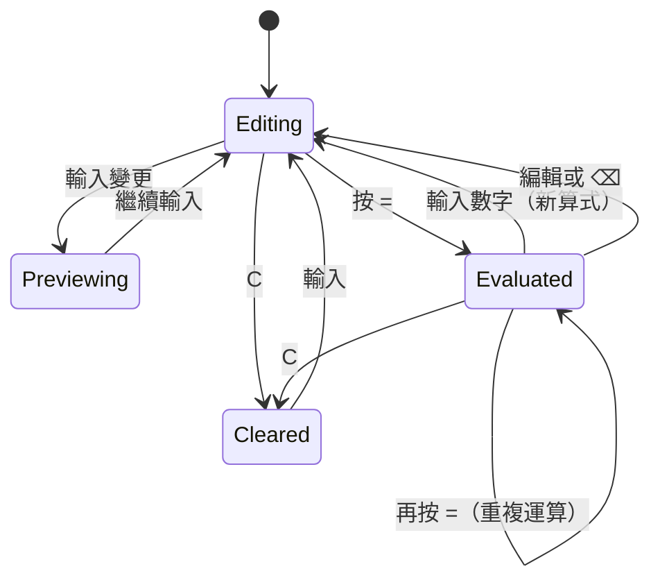

# 系統設計文件

本文件說明 mini計算機的設計目標、需求、介面與行為設計。對應版本 1.5.1。

## 1. 設計目標

1. **快速**：啟動到可互動的時間盡量短，日常計算不需等待。
2. **直覺**：運算式可直接編輯，結果即時預覽，按鍵配置符合 Windows 小算盤習慣。
3. **一致**：標準與科學模式共用同一套求值引擎、記憶體、歷史與主題。
4. **輕量**：不連網、不常駐、不收集資料，關閉即結束。
5. **可維護**：MVVM 分層、依賴注入、集中套件版本、可測試的求值引擎。
6. **可辨識**：12 款主題色 × 淺色／深色，提供個人化但維持可讀性。

## 2. 範圍

### 納入範圍

- 標準計算：四則運算、括號、百分比、倒數、平方、根號、正負號。
- 科學計算：三角／反三角、雙曲／反雙曲、對數、指數、次方、根、階乘、`mod`、常數、隨機數、度分秒、科學記號。
- 單槽記憶體與歷史紀錄。
- 主題、顯示模式、視窗置頂、視窗狀態記憶。
- 單一實例、鍵盤操作、剪貼簿、無障礙名稱。
- x64 與 ARM64 非 Self-Contained 發佈。

### 不納入範圍

- 程式設計師模式（進位轉換、位元運算）。
- 匯率、單位換算、日期計算。
- 雲端同步、帳號、網路功能。
- MSIX／MSI 安裝封裝。
- 系統匣常駐。

## 3. 使用者與情境

| 情境 | 需求 |
| --- | --- |
| 日常快速計算 | 開程式即輸入，`Enter` 得到結果 |
| 工程或數學計算 | 科學函式、角度單位、科學記號 |
| 連續同運算 | 連按 `=` 重複加減乘除 |
| 查詢先前計算 | 歷史紀錄顯示時間，可回填 |
| 長時間使用 | 深色模式、護眼配色、視窗置頂 |
| 鍵盤使用者 | 完整鍵盤輸入與快捷鍵 |
| 輔助技術使用者 | 螢幕閱讀器名稱與可見焦點 |

## 4. 功能需求

### 4.1 計算

- 支援運算子優先序與括號。
- 缺少右括號時自動補齊；多出右括號視為語法錯誤。
- 支援隱含乘法，但不可誤判科學記號。
- 錯誤需分類為語法、除以零、定義域、溢位，並以在地化訊息顯示。
- 結果格式：16 位有效數字、千分位、必要時科學記號。
- 可複製格式化結果與原始值。

### 4.2 模式

- 標準與科學模式共用 `CalculatorViewModel` 與 `CalculatorEngine`。
- 記住上次使用模式，下次啟動還原。
- 切換模式時只建立需要的面板，並快取已建立面板。

### 4.3 記憶體

- 單槽，標準與科學共用。
- 支援 `MC`、`MR`、`M+`、`M−`、`MS`。
- 值持久化於設定檔。
- 空記憶體按 `MR` 顯示狀態提示，不視為錯誤。

### 4.4 歷史

- 每次按 `=` 成功計算後新增一筆。
- 顯示運算式、結果與時間。
- 最多 100 筆，新的在前。
- 支援雙擊或 `Enter` 回填、`Esc` 關閉。
- 清除需二次確認。

### 4.5 外觀

- 顯示模式：跟隨系統、淺色、深色。
- 12 款主題色，每款支援兩種模式。
- 主題切換即時生效。
- 顏色不得寫死在 XAML，需使用主題資源。

### 4.6 視窗

- 最小尺寸 440×620。
- 關閉即結束程式。
- 保存位置、大小與最大化狀態。
- 還原時避免超出工作區。
- 可置頂。
- 單一實例，第二次啟動帶回既有視窗。

## 5. 非功能需求

| 項目 | 目標 |
| --- | --- |
| 啟動 | Debug 啟動到可互動約 500–520ms（參考值） |
| 輸入反應 | 即時預覽節流 100ms |
| 儲存 | 背景延遲合併寫入，不阻塞 UI |
| 可靠性 | 設定／歷史損毀時可回退預設值 |
| 隱私 | 不連網、不上傳、不外傳 |
| 可及性 | 可點擊元素有名稱、圖示有 ToolTip、焦點可見 |
| 可攜性 | x64 與 ARM64 皆可執行 |

## 6. 介面設計

### 6.1 主視窗配置

```text
┌──────────────────────────────────────────────────────┐
│ mini計算機   [標準] [科學]          [釘選] [歷史] [設定] │
├──────────────────────────────────────────────────────┤
│                                                      │
│  運算式列（可編輯）                                   │
│  結果列（即時預覽／正式結果）        [複製原始] [複製] │
│  狀態訊息                                            │
│                                                      │
│  ┌────────────────────────────────────────────────┐  │
│  │                標準或科學鍵盤                   │  │
│  └────────────────────────────────────────────────┘  │
└──────────────────────────────────────────────────────┘
```

### 6.2 標準模式鍵盤

- 第一列：記憶體 `MC`、`MR`、`M+`、`M−`、`MS`
- 第二列：`%`、`CE`、`C`、`⌫`、`1/x`、`x²`、`√`
- 数字區：`7 8 9 ÷`、`4 5 6 ×`、`1 2 3 −`
- 底部：`± 0 . + =`

### 6.3 科學模式鍵盤

- 頂部：`2nd`、`hyp`、角度單位、`F-E`、括號
- 函式區：三角、對數、指數、次方、根、`abs`、`floor`、`ceil`、`round`、`n!`、`mod`、`rand`、`π`、`e`、`DMS`
- 數字與記憶體區與標準模式一致
- 使用 `UniformGrid` 平均分配列高，最小視窗下仍可完整顯示

### 6.4 設定視窗

- 顯示模式：三段膠囊按鈕。
- 主題色：5×2 圓形色票方格，附主題名稱。
- 恢復預設值：二次確認。
- 底部關於資訊：產品名稱、版本、檔案版本、授權、隱私。
- `Esc` 關閉。

## 7. 狀態模型

### 7.1 計算狀態



關鍵旗標：

- `_justEvaluated`：是否剛完成計算。
- `_repeatOperator`／`_repeatOperand`：上次二元運算。
- `_suppressPreview`：避免在特定流程覆蓋結果。
- `_statusTimer`：狀態訊息顯示 2 秒。

### 7.2 模式狀態

- `ShellViewModel.IsStandardSelected` 與 `IsScientificSelected` 互斥。
- 變更會同步 `AppSettings.IsScientificMode`。
- `AppSettings` 變更會回寫選取狀態，避免設定重設後不同步。

### 7.3 設定狀態

```text
AppSettings
├─ DisplayMode
├─ Theme
├─ AlwaysOnTop
├─ AngleUnit
├─ Memory
├─ IsScientificMode
├─ ScientificNotation
└─ Window
   ├─ HasValue
   ├─ Left / Top / Width / Height
   └─ Maximized
```

## 8. 關鍵流程

### 8.1 輸入與預覽

1. 使用者按鍵或鍵盤輸入。
2. `InsertCommand` 依目前游標位置插入 token。
3. 若剛按 `=` 且輸入數字，先清空運算式。
4. 啟動 100ms 預覽 Timer。
5. 求值成功顯示結果；失敗顯示錯誤，但不寫入歷史。

### 8.2 計算與歷史

1. 按 `=` 或 `Enter`。
2. 取消待處理預覽。
3. 求值。
4. 成功：更新結果、寫入歷史、記錄重複運算、設定 `_justEvaluated`。
5. 失敗：顯示錯誤、不寫入歷史。

### 8.3 連按等號

1. 第一次 `=` 記錄最右側頂層運算子與右運算元。
2. 後續 `=` 以目前結果作為左運算元重複運算。
3. 左運算元為負數時加括號，避免 `-4 ^ 2` 被解析為 `-(4^2)`。
4. 若無可用運算子，維持目前結果。

### 8.4 主題切換

1. 使用者在設定頁選擇模式或主題。
2. `AppSettings` 屬性變更。
3. `ThemeService` 解析有效模式（跟隨系統時讀 Registry）。
4. 移除舊主題字典，加入新字典到最後。
5. `DynamicResource` 筆刷即時更新。

## 9. 錯誤與回饋設計

| 情境 | 回饋 |
| --- | --- |
| 語法錯誤 | 結果列顯示在地化錯誤 |
| 除以零 | 顯示除零錯誤 |
| 定義域錯誤 | 顯示無效輸入 |
| 溢位 | 顯示數值過大 |
| 記憶體為空按 `MR` | 短暫狀態訊息 |
| 複製成功 | 「已複製」提示 2 秒 |
| 清除歷史／恢復預設 | 二次確認對話框 |
| 未處理例外 | 記錄日誌並顯示錯誤訊息 |

錯誤訊息使用固定字級與高度策略，避免顯示區跳動。

## 10. 色彩與主題設計

### 10.1 原則

- 淺色：粉彩底 + 鮮明主色。
- 深色：帶色相深底 + 明亮主色。
- 主色按鈕前景依亮度選擇白色或深墨，維持對比。
- 護眼黃、夕陽橘、青碧的淺色主色使用深色文字。

### 10.2 筆刷分類

每份主題字典定義 18 個筆刷，包含：

- 視窗與面板背景
- 主要／次要文字
- 邊框與分隔線
- 一般按鍵、函式鍵、記憶體鍵、重點鍵（含 hover／pressed）
- 輸入框與焦點
- 錯誤與狀態色

### 10.3 色票

設定頁的色票使用獨立字典，確保在目前主題下仍顯示各主題的代表色。

## 11. 資料設計

### 11.1 settings.json

```json
{
  "displayMode": "System",
  "theme": "ClassicBlue",
  "alwaysOnTop": false,
  "angleUnit": "Deg",
  "memory": 0,
  "isScientificMode": false,
  "scientificNotation": false,
  "window": {
    "hasValue": true,
    "left": 100,
    "top": 100,
    "width": 520,
    "height": 780,
    "maximized": false
  }
}
```

### 11.2 history.json

```json
[
  {
    "expression": "2+3",
    "result": "5",
    "createdAt": "2026-11-26T12:00:00+08:00"
  }
]
```

### 11.3 相容性

- 未知欄位在讀取時忽略。
- 缺少欄位使用預設值。
- 列舉以字串儲存，避免重新排序造成語意改變。

## 12. 無障礙設計

- 所有符號按鈕提供 `AutomationProperties.Name`。
- 圖示按鈕提供 ToolTip。
- 鍵盤 Tab 有可見焦點框。
- 運算式輸入框有提示文字。
- 錯誤訊息不依賴顏色單獨表達。
- 主要操作皆可用鍵盤完成。

## 13. 測試設計

| 類型 | 範圍 |
| --- | --- |
| 單元測試 | 求值引擎、格式化、ViewModel 命令與狀態 |
| 建置驗證 | `dotnet build`、`dotnet format --verify-no-changes` |
| 手動驗證 | 主題切換、視窗還原、鍵盤操作、剪貼簿 |
| 發佈驗證 | x64／ARM64 壓縮檔可啟動、版本正確 |

未來可加入：

- 色彩對比自動檢測。
- 啟動效能基準。
- UI 自動化測試。

## 14. 發佈設計

- 版本集中於 `Directory.Build.props`。
- Release 產物為 framework-dependent zip，不含安裝程式。
- 檔名包含版本與架構：
  - `MiniCalculator-1.5.1-win-x64.zip`
  - `MiniCalculator-1.5.1-win-arm64.zip`
- Release 說明包含系統需求、下載表、更新內容與隱私說明。
- 不自動發佈 `Release` 組態，僅在明確發佈時執行。

## 15. 風險與取捨

| 風險 | 取捨 |
| --- | --- |
| 非自包含版本需另裝執行階段 | 換取較小下載與較快發佈 |
| 未簽章執行檔可能觸發 SmartScreen | 目前不提供簽章憑證 |
| 科學模式按鍵密集 | 以 UniformGrid 與最小高度控制確保可見 |
| 主題字典數量多 | 以直接定義筆刷換取即時切換可靠性 |
| 無網路功能 | 無法提供雲端同步，但降低隱私風險 |

## 16. 相關文件

- [使用指南](USER_GUIDE.md)
- [系統架構與技術文件](ARCHITECTURE.md)
- [建置與發佈](BUILD_AND_RELEASE.md)
- [隱私說明](PRIVACY.md)
- [開發紀錄](DEV_LOG.md)
